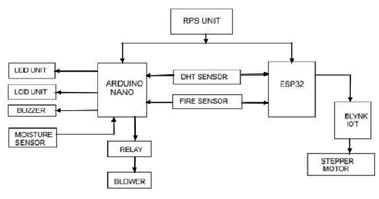

#  Smart Seed Preservation System Using IoT

An IoT-based seed preservation system using Arduino, environmental sensors, an LCD display, a fan, a fire sensor, and the Blynk IoT platform for real-time monitoring.

##  Project Overview

The Smart Seed Preservation System is designed to monitor environmental conditions relevant to seed storage and support safer storage management. It integrates temperature and humidity monitoring, soil moisture sensing, a local LCD display, and remote monitoring through the Blynk IoT platform.

A fan and fire sensor are incorporated into the system to support environmental control and fire detection. The system demonstrates the integration of embedded systems, sensors, and IoT technology.

##  Objectives

- Monitor temperature and humidity using the DHT11 sensor.
- Measure moisture levels using a soil moisture sensor.
- Display sensor readings on an LCD display.
- Enable real-time remote monitoring through the Blynk IoT platform.
- Use a fan to support ventilation or temperature management according to the programmed logic.
- Detect fire using a fire sensor.
- Control connected equipment through a relay module, where implemented.

##  Hardware Components

- Arduino microcontroller
- DHT11 temperature and humidity sensor
- Soil moisture sensor
- LCD display
- Fire sensor
- Fan
- Relay module
- Connecting wires
- Power supply

##  Technologies Used

- Embedded C / Arduino programming
- Arduino IDE
- Blynk IoT platform
- Internet of Things (IoT)
- Sensor interfacing
- Embedded systems and automation

##  Working Principle

1. The DHT11 sensor measures the surrounding temperature and humidity.
2. The soil moisture sensor measures moisture levels.
3. The fire sensor detects fire-related signals in its sensing area.
4. The Arduino processes the sensor readings and displays relevant information on the LCD.
5. The Blynk IoT platform enables real-time remote monitoring of configured sensor data.
6. The fan and relay module operate according to the control logic programmed into the system.

##  IoT Integration and Real-Time Monitoring

The system is connected to the Blynk IoT platform, allowing users to monitor configured environmental readings remotely through a Blynk dashboard.

The LCD provides local monitoring, while Blynk offers remote access to sensor data, helping users observe storage conditions conveniently.

##  Block Diagram

##  Future Improvements

- Add notifications when temperature or humidity exceeds configured limits.
- Implement fire alerts through the IoT dashboard.
- Add historical sensor data logging and visualization.
- Improve automated ventilation and environmental control.
- Enhance remote monitoring and system reliability.

##  Learning Outcomes

- Arduino programming and embedded system development.
- Interfacing temperature, humidity, soil moisture, and fire sensors.
- LCD interfacing for local data display.
- IoT integration using the Blynk platform.
- Real-time environmental monitoring.
- Hardware and software integration for automation.

##  Author

**Puneet Janganuri**  

---

*Academic project demonstrating embedded systems, IoT-based real-time monitoring, sensor interfacing, and environmental control.*
